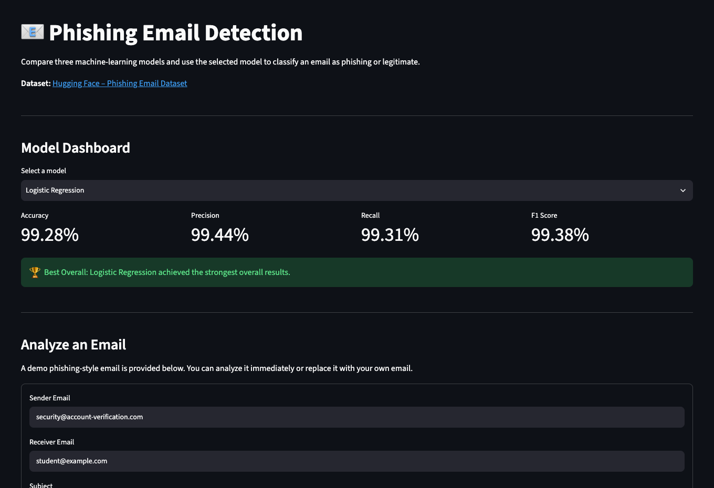
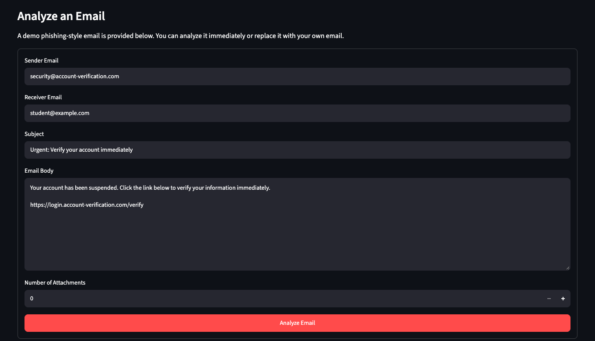
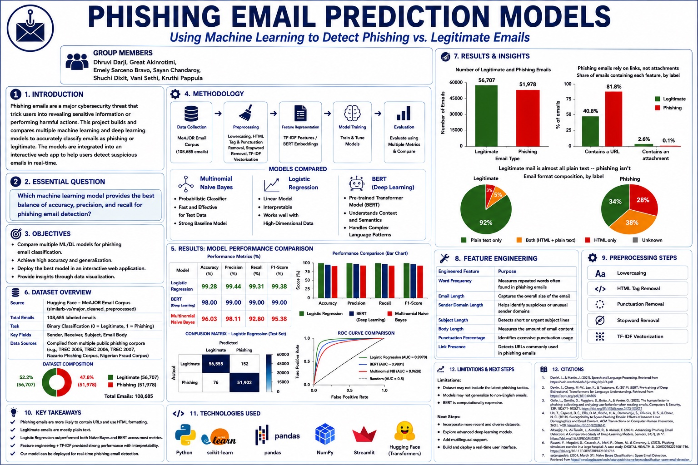

# Phishing Email Prediction Models

Which machine-learning model catches phishing emails best? Our team of seven compared three models of increasing complexity on 108,685 labeled emails, from a simple baseline to a fine-tuned transformer. **The simplest one won**: TF-IDF with logistic regression reached 99.28% accuracy, beating BERT while costing a fraction of the compute. We deployed all three in a Streamlit app that classifies an email in real time.

Built for the **AI4ALL Ignite** accelerator, Summer 2026.

**[Try the live app](https://phishing-email-predictor-ml.streamlit.app/)** · [Research poster](https://docs.google.com/presentation/d/17QK_cO5B9MC6ut8yqIqerbolAExAoAJpqiEn5AQvHo4/edit?usp=sharing) · [Final presentation](https://docs.google.com/presentation/d/1cAEnQsrmyYBiYwIbXisz234soKgXjEnGFH2njkTOQxQ/edit) · [Case study](https://portfolio-emelysarcenobravo.vercel.app/work/phishing-detection)

> This is my fork of the [team repository](https://github.com/dhruvidarji1/Phishing-Email-Prediction-Models). My contributions are listed [below](#my-contribution).

## Why this matters

Phishing is one of the most common cybersecurity threats, and it keeps getting harder to spot. One click can mean stolen credentials, identity theft or a data breach, and email is still how most people and organizations communicate.

Automated detection flags suspicious emails faster and at a larger scale than manual review, giving people a warning before they interact with something malicious. But a filter is only useful if people trust it: one that blocks too much gets ignored, and one that misses too much is dangerous. So our research question was deliberately narrow:

> **Which model gives the best balance of accuracy, precision and recall for phishing detection?**

## The app

Pick a model, paste in an email, and get a phishing or legitimate prediction along with the features the model extracted.

<table>
  <tr>
    <td align="center" valign="top" width="50%">
      <br>
      <sub>Compare each model's scores.</sub>
    </td>
    <td align="center" valign="top" width="50%">
      <br>
      <sub>Analyze a demo phishing email, or paste in your own.</sub>
    </td>
  </tr>
</table>

## Results

All three models were trained on the same features and judged by the same four metrics on a held-out test set.

| Model | Accuracy | Precision | Recall | F1 |
|---|---|---|---|---|
| **Logistic regression** (TF-IDF features) | **99.28%** | **99.44%** | **99.31%** | **99.38%** |
| DistilBERT (fine-tuned transformer) | 98% | 99% | 99% | 99% |
| Multinomial Naive Bayes (probabilistic baseline) | 96.03% | 98.11% | 92.80% | 95.38% |

**What the numbers mean:**

- **Logistic regression won on every metric.** It trains in minutes, runs without a GPU, and is easy to explain, which makes it the practical choice for a real filter.
- **DistilBERT came close but cost far more.** It reads context, but it needs a GPU and much more time to train and run.
- **Naive Bayes missed the most phishing.** Its 98% precision looks strong, but 92.8% recall means about 7 in 100 phishing emails got through. Accuracy alone would have hidden that.

### What the data showed

| Signal | Phishing emails | Legitimate emails |
|---|---|---|
| Contain a link | 81.8% | 40.8% |
| Use HTML | 66% | 8% |
| Have an attachment | 0.1% | 2.6% |

Attackers rely on links, not files, which is why URL features carried so much weight.

## Research poster

<a href="https://docs.google.com/presentation/d/17QK_cO5B9MC6ut8yqIqerbolAExAoAJpqiEn5AQvHo4/edit?usp=sharing"></a>

<sub>Click the poster to open it in Google Slides.</sub>

## How it works

```
108,685 labeled emails
  → clean text (lowercase, strip HTML, remove punctuation and stop words)
  → engineer features (length, links, typos, punctuation, sender domain, attachments)
  → train three models on the same features
  → evaluate on accuracy, precision, recall and F1
  → deploy in Streamlit
```

**Why these three models?** Each one represents a different level of complexity, so the comparison shows whether the extra cost of a bigger model is worth it:

- **Logistic regression:** a fast, interpretable baseline that outputs a confidence score between 0 and 1.
- **Multinomial Naive Bayes:** a classic spam filter. It trains in one pass but assumes words are independent of each other.
- **DistilBERT:** transfer learning from a pre-trained transformer. It understands context, but needs a GPU and far more time.

**A fair comparison.** Our first plan used every column in the dataset, but some were redundant or incompatible with certain models. We narrowed the input to a shared feature set so differences in results came from the models, not the data.

**Dataset.** The MeAJOR Email Corpus: 108,685 labeled emails merged from TREC 2005–2007, the Nazario phishing corpus, the Nigerian fraud corpus and other open datasets.

## My contribution

- **Built and evaluated the Multinomial Naive Bayes model** in Python and scikit-learn: 96.03% accuracy and a 95.38% F1 score (`MultinomialNaiveBayes.ipynb`).
- **Engineered features** with TF-IDF plus email length, punctuation, URLs, sender domains and attachments, to extract predictive signals.
- **Analyzed the class distribution,** showing the dataset was imbalanced but still large enough for reliable training and testing.
- **Wrote the bias analysis** covering temporal, labeling, organizational, language and cultural bias in the training data.
- **Deployed the Streamlit app** from this fork to Streamlit Community Cloud.
- **Co-authored the research proposal** and presented my sections in the team's final presentation.

## Limitations and bias

Most legitimate emails in the dataset come from Enron's 2001 corporate mailboxes: mostly English, North American and from the early 2000s. That shapes what the model learns:

- **Temporal bias:** older emails don't reflect current phishing tactics, including AI-written phishing.
- **Labeling bias:** borderline emails may be mislabeled.
- **Organizational bias:** mostly corporate settings and writing styles.
- **Language and cultural bias:** a model trained on this data may flag informal or non-native writers as suspicious.

A better model can reduce some of this bias, but it can't erase it. **Next steps:** train on more recent and multilingual data, test newer language models, and show users a confidence score with the warning signs that triggered it, instead of a bare yes or no.

## Running it locally

**You'll need:** Python 3.11 and [Git LFS](https://git-lfs.com/), which downloads the fine-tuned DistilBERT model.

```bash
git lfs install
git clone https://github.com/emelysarcenobravo/Phishing-Email-Prediction-Models.git
cd Phishing-Email-Prediction-Models

python -m venv .venv
source .venv/bin/activate        # on Windows: .venv\Scripts\activate
pip install -r requirements.txt

streamlit run app.py             # opens http://localhost:8501
```

**What's in the repo:**

| File | What it is |
|---|---|
| `app.py` | The Streamlit app |
| `logistic_predictor.py`, `naive_bayes_predictor.py`, `bert_predictor.py` | Load each trained model and prepare an email for prediction |
| `custom_transformers.py` | A custom scikit-learn transformer used in the logistic regression pipeline |
| `models/` | The trained models |
| `*.ipynb` | Training and evaluation notebooks for each model |
| `test_models.py` | Quick checks that each model loads and predicts |

## What I learned

- **Make complex models earn their place.** I expected BERT to win because it understands context. A well-featured logistic regression beat it on every metric. Now I start with the simplest model that could work.
- **The metric you choose is a decision about people.** What counts as "best" depends on what a mistake costs the person receiving the email.
- **Bias lives in the data's history.** Where training data comes from shapes who a model will treat unfairly.

## Tech stack

Python · scikit-learn · pandas · NumPy · Hugging Face Transformers · DistilBERT · PyTorch · Streamlit · Joblib
